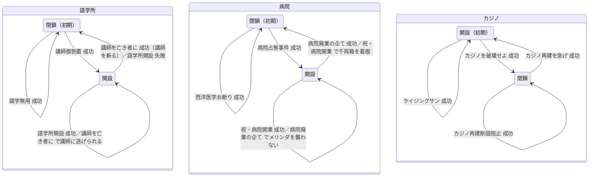

# 侍道4 イベント遷移

ゲーム内のイベントチャート（スタートメニュー「状況」）の遷移と発生条件をまとめたもの。
セーブ形式の解析結果ではなく、**外部 Wiki の攻略情報の要約**である。セーブ上のイベント進行は [event-chart](save_format/chunks/event-chart/README.md) を参照。

## 出典

2026-10-05 に取得。

- [A] 侍道4攻略@wiki「イベント」 https://w.atwiki.jp/samuraidou4/pages/44.html （最終更新 2024-11-25）— 条件・分岐の主な出典
- [F] Way of the Samurai Wiki "Way of the Samurai 4 Events" https://wots.fandom.com/wiki/Way_of_the_Samurai_4_Events — 英語名、チャート上の位置、時間帯

英語名と日本語名の対応は、[F] のチャート上の位置と [A] の説明を突き合わせて付けた。突き合わせに自信がないものには 🔶 を付ける。

## 全体の前提

- 1〜3日目は昼・夕・夜の3枠。各枠で、攘夷・幕府・外国それぞれのイベントが1つずつ（施設の状態によって2つのうちどちらか）用意されている
- 4日目以降と隠しルートは、日数の経過と関係なく進む [A]
- 1〜3日目の報酬つきイベントは、基本的に大成功 1500文、成功・失敗 500文 [A]
- 2日目のイベントは主に施設（語学所・病院・カジノ）の開設・閉鎖にかかわる。施設の状態は周回をまたいで引き継がれる（[facilities](save_format/chunks/facilities/README.md)）
- 4日目の勢力イベントに参加するには、その勢力のイベントに2つ以上参加し、その勢力に敵対するイベント（勢力の人物を斬るものなど）に参加していないことが必要 [F]。
  [factions](save_format/chunks/factions/README.md) のゲーム側の仕様は「剣術大会の時点で友好度3以上の勢力のルートに進む」としており、どちらが正しいかは要ゲーム内確認。
  → [U] 2026-10-05：幕府のイベントに2回参加では公儀の剣が出ず、3回目（剣術大会の準備）のあとの大寄せで出た。**条件は3回以上**（[factions](save_format/chunks/factions/README.md)）
- 宿屋で寝ると治安が良くなり、野宿すると悪くなる。寝ることで一部のイベントを飛ばせる [F]

## イベントチャート

スタートメニュー「状況」のチャートと同じ列の並び（[F] のチャート上の位置）で、全イベントの遷移を1枚にまとめたもの。分岐の条件は下の各表 [A] から取った。

凡例：
- 色：赤＝攘夷（般若党）、緑＝幕府、青＝外国、黄＝その他、紫＝隠しルート
- 線：実線＝通常の進行、点線＝寝返り・失敗・特殊条件による分岐
- 形：角丸＝エンディング、黒丸＝その時間帯のどのイベントからでも次へ進む合流点
- 2日目のイベントは施設の状態によって、同じ枠の2つのうちどちらかが起こる

描画したときのエンディングの並びは Mermaid のレイアウト（dagre）が決めるので、ゲーム内の並びとは一致しない。

```mermaid
flowchart LR
  %% クラス名に hidden を使うと、表示側の CSS の .hidden { display: none } に当たってノードが消えるので避ける
  classDef prajna fill:#EACCCA,stroke:#B5514F,color:#000
  classDef shogunate fill:#D5E8C8,stroke:#6A9A4F,color:#000
  classDef foreigners fill:#CDDFE9,stroke:#5991B6,color:#000
  classDef other fill:#EDE7CD,stroke:#C4B35B,color:#000
  classDef hiddenroute fill:#E2CEE7,stroke:#8E5A9B,color:#000
  classDef junction fill:#333,stroke:#333

  subgraph P01["1日目 昼"]
    E01["オープニング"]:::other
    E02["阿弥浜港争乱"]:::other
    E03["嵐の後"]:::other
    E04["志士との出会い"]:::prajna
    E05["代官所の面々"]:::shogunate
    E06["小公女謁見"]:::foreigners
    E07["簀巻き日和"]:::other
    E08["三姉妹見参"]:::hiddenroute
  end
  subgraph P02["1日目 夕"]
    E09["海兵隊の横暴"]:::prajna
    E10["琴吹光探検隊"]:::shogunate
    E11["電信あり"]:::foreigners
    E12["お早い到着"]:::hiddenroute
  end
  subgraph P03["1日目 夜"]
    E13["代官所潜入"]:::prajna
    E14["阿片密売を阻止せよ"]:::shogunate
    E15["辻斬りを辻斬る"]:::foreigners
    E16["再起の望み"]:::hiddenroute
  end
  subgraph P04["2日目 昼"]
    E17["欺きの代価"]:::prajna
    E18["西洋医学お断り<br/>（病院 閉鎖時）"]:::shogunate
    E19["病院廃業の企て<br/>（病院 開設時）"]:::shogunate
    E20["病院占拠事件<br/>（病院 閉鎖時）"]:::foreigners
    E21["祝・病院開業<br/>（病院 開設時）"]:::foreigners
    E22["将の器"]:::hiddenroute
    E23["怒りの矛先"]:::hiddenroute
  end
  subgraph P05["2日目 夕"]
    E24["語学無用<br/>（語学所 閉鎖時）"]:::prajna
    E25["講師を亡き者に<br/>（語学所 開設時）"]:::prajna
    E26["講師御到着<br/>（語学所 閉鎖時）"]:::shogunate
    E27["語学所開設<br/>（語学所 開設時）"]:::shogunate
    E28["お団子物語"]:::foreigners
    E29["伯爵に刺激を"]:::hiddenroute
    E30["運命のルーレット"]:::hiddenroute
  end
  subgraph P06["2日目 夜"]
    E31["カジノを破壊せよ<br/>（カジノ 開設時）"]:::prajna
    E32["カジノ再建断固阻止<br/>（カジノ 閉鎖時）"]:::prajna
    E33["ガイジンとゲイシャ"]:::shogunate
    E34["ライジングサン<br/>（カジノ 開設時）"]:::foreigners
    E35["カジノ再建を急げ<br/>（カジノ 閉鎖時）"]:::foreigners
    E36["闇討ち"]:::hiddenroute
  end
  subgraph P07["3日目 全体"]
    E37["大老 鬼怒川怨仙"]:::other
    E38["学問のすすめ"]:::hiddenroute
  end
  subgraph P08["3日目 昼"]
    E39["血で血を洗う戦い"]:::prajna
    E40["魔鱗組の力"]:::shogunate
    E41["小公女と大老"]:::foreigners
    E42["白昼の激突"]:::other
  end
  subgraph P09["3日目 夕"]
    E43["売国奴を斬れ"]:::prajna
    E44["大老と三姉妹"]:::shogunate
    E45["小公女倒れる"]:::foreigners
    E46["刺激が欲しい"]:::hiddenroute
    E47["傷心の帰国船"]:::hiddenroute
  end
  subgraph P10["3日目 夜"]
    E48["夜の墓場で"]:::prajna
    E49["真実"]:::prajna
    E50["伯爵救出"]:::hiddenroute
    E51["仕組まれた襲撃"]:::prajna
    E52["罠を破れ"]:::prajna
    E53["剣術大会の準備"]:::shogunate
    E54["危険な賭け"]:::foreigners
  end
  subgraph P11["4日目以降（1）"]
    E55["大老の大寄せ"]:::other
    E56["人間湯通しの恐怖"]:::hiddenroute
    E57["大老暗殺計画"]:::hiddenroute
  end
  subgraph P12["4日目以降（2）"]
    E58["志士の刀"]:::prajna
    E59["公儀の剣"]:::shogunate
    E60["東国の騎士"]:::foreigners
    E61["根無し草"]:::other
  end
  subgraph P13["4日目以降（3）"]
    E62["剣術大会開催"]:::other
  end
  subgraph P14["4日目以降（4）"]
    E63["覇者となる"]:::other
    E64["最後通告"]:::other
    E65["ローラの決意"]:::hiddenroute
  end
  subgraph P15["4日目以降（5）"]
    E66["臆病風"]:::prajna
    E67["闇黒の意志"]:::shogunate
    E68["願い虚しく"]:::foreigners
    E69["士魂は屈せず"]:::hiddenroute
  end
  subgraph P16["4日目以降（6）"]
    E70["同士救出"]:::prajna
    E71["大老武断"]:::shogunate
    E72["憂国の士"]:::shogunate
    E73["鬼怒川の魔手"]:::foreigners
    E74["ローラ奪還"]:::hiddenroute
  end
  subgraph P17["4日目以降（7）"]
    E75["領事館斬り込み"]:::prajna
    E76["般若党壊滅"]:::shogunate
    E77["三匹で斬る"]:::shogunate
    E78["夕暮れの船上"]:::foreigners
    E79["鬼怒川を追え"]:::hiddenroute
  end
  subgraph P18["4日目以降（8）"]
    E80["武士の魂"]:::prajna
    E81["黒船を我が手に"]:::shogunate
    E82["討ち入り"]:::foreigners
    E83["黒船の決闘"]:::hiddenroute
  end
  subgraph P19["4日目以降（9）"]
    E84["剣客茂呂茂"]:::shogunate
    E85["武人琴吹光"]:::shogunate
  end
  subgraph P20["エンディング"]
    E86(["攘夷の炎"]):::prajna
    E87(["熱き魂"]):::prajna
    E88(["破滅への道"]):::shogunate
    E89(["変わり往く心"]):::shogunate
    E90(["海外雄飛"]):::foreigners
    E91(["侍一直線"]):::foreigners
    E92(["魔鱗組として"]):::other
    E93(["釜茹で侍"]):::other
    E94(["希望の光"]):::hiddenroute
    E95(["大老は生きていた"]):::hiddenroute
  end

  %% ---- 1日目 ----
  E01 --> E02
  E01 -.->|"2周目以降・人だかりを避けて再訪"| E03
  E02 --> E04
  E02 --> E05
  E02 --> E06
  E03 -->|"昼はこれだけ"| E04
  E02 -.->|"般若党戦で降参"| E07
  E02 -.->|"大砲の般若党2人を撃破"| E08

  J_D1D(( ))
  E04 --- J_D1D
  E05 --- J_D1D
  E06 --- J_D1D
  E07 --- J_D1D
  J_D1D --> E09
  J_D1D --> E10
  J_D1D --> E11

  J_D1E(( ))
  E09 --- J_D1E
  E10 --- J_D1E
  E11 --- J_D1E
  J_D1E --> E13
  J_D1E --> E14
  J_D1E --> E15

  %% ---- 2日目（施設の状態で、同じ枠の2つのうちどちらかが起こる）----
  J_D1N(( ))
  E13 --- J_D1N
  E14 --- J_D1N
  E15 --- J_D1N
  J_D1N --> E17
  J_D1N --> E18
  J_D1N --> E19
  J_D1N --> E20
  J_D1N --> E21

  J_D2D(( ))
  E17 --- J_D2D
  E18 --- J_D2D
  E19 --- J_D2D
  E20 --- J_D2D
  E21 --- J_D2D
  J_D2D --> E24
  J_D2D --> E25
  J_D2D --> E26
  J_D2D --> E27
  J_D2D --> E28

  J_D2E(( ))
  E24 --- J_D2E
  E25 --- J_D2E
  E26 --- J_D2E
  E27 --- J_D2E
  E28 --- J_D2E
  J_D2E --> E31
  J_D2E --> E32
  J_D2E --> E33
  J_D2E --> E34
  J_D2E --> E35

  %% ---- 3日目 ----
  J_D2N(( ))
  E31 --- J_D2N
  E32 --- J_D2N
  E33 --- J_D2N
  E34 --- J_D2N
  E35 --- J_D2N
  J_D2N --> E37
  E37 --> E39
  E37 --> E40
  E37 --> E41
  E39 <-.->|"友好度が高い側へ寝返り"| E40
  E39 -.->|"赤城の誘いを断る"| E42
  E40 -.->|"琴吹らと徹底抗戦／逃走"| E42
  E42 -->|"赤城に助太刀"| E39
  E42 -->|"琴吹に助太刀"| E40

  J_D3D(( ))
  E39 --- J_D3D
  E40 --- J_D3D
  E41 --- J_D3D
  J_D3D --> E43
  J_D3D --> E44
  J_D3D --> E45

  J_D3E(( ))
  E43 --- J_D3E
  E44 --- J_D3E
  E45 --- J_D3E
  J_D3E -->|"売国奴を斬れ 未発生で墓場へ"| E48
  E43 -->|"墓場へ"| E49
  J_D3E -->|"真実 未発生で港へ"| E51
  E49 -->|"まだらに勝ち、港へ"| E52
  E52 -.->|"赤城の説得に失敗"| E51
  J_D3E --> E53
  J_D3E --> E54

  %% ---- 4日目以降 ----
  J_D3N(( ))
  E48 --- J_D3N
  E51 --- J_D3N
  E52 --- J_D3N
  E53 --- J_D3N
  E54 --- J_D3N
  J_D3N --> E55
  E55 -->|"攘夷ルート"| E58
  E55 -->|"幕府ルート・茂呂が生存"| E59
  E55 -->|"外国ルート"| E60
  E55 -->|"無所属"| E61

  J_COOP(( ))
  E58 --- J_COOP
  E59 --- J_COOP
  E60 --- J_COOP
  J_COOP -->|"協力"| E62
  E61 --> E62
  E62 -->|"勢力ルートで3連勝"| E63
  E62 -.->|"負けを認める"| E64
  E62 -->|"無所属で優勝"| E92
  E63 -->|"表彰台に上る"| E93
  E63 -->|"辞退（攘夷）"| E66
  E63 -->|"辞退（幕府）"| E67
  E63 -->|"辞退（外国）"| E68

  %% 攘夷ルート
  E66 -->|"赤城に協力"| E70
  E70 -->|"旅籠で赤城に協力"| E75
  E75 -->|"真実を通っている"| E80
  E75 -->|"真実を通っていない"| E87
  E80 -->|"琴吹と三姉妹を倒す"| E86

  %% 幕府ルート
  E67 -->|"大老に賛同"| E71
  E67 -->|"大老に逆らう"| E72
  E71 --> E76
  E76 --> E81
  E81 -->|"黒船の船長室へ"| E84
  E84 -->|"茂呂に勝つ"| E88
  E72 --> E77
  E77 --> E85
  E85 -->|"全員倒す"| E89

  %% 外国ルート
  E68 --> E73
  E73 -->|"ローラを守りきる"| E78
  E73 -.->|"ローラが死亡"| E82
  E78 -->|"ローラの誘いに乗る"| E90
  E78 -->|"誘いを断る"| E82
  E82 -->|"三姉妹に勝つ"| E91

  %% 隠しルート
  E08 -->|"三姉妹を全員倒す"| E12
  E12 -->|"琴吹／魔鱗組を倒す"| E16
  E16 -->|"瀕死の赤城を病院へ"| E22
  E16 -.->|"病院がない／連れて行かない"| E23
  E22 -->|"カジノ 閉鎖"| E29
  E22 -->|"カジノ 開設"| E30
  E23 --> E57
  E29 --> E36
  E30 --> E36
  E36 -->|"小暮を峰打ちで説得（語学所 開設）"| E38
  E36 -.->|"茂呂か小暮が死ぬ"| E57
  E38 -->|"J.J を倒していない"| E46
  E38 -.->|"J.J を倒している"| E47
  E47 --> E57
  E46 -->|"希望の光・ED 確定"| E50
  E50 --> E56
  E56 --> E65
  E65 --> E69
  E69 -->|"獄門塔から出る"| E74
  E74 --> E79
  E79 --> E83
  E83 -->|"鬼怒川を倒す"| E94
  E57 -->|"偽鬼怒川を倒す"| E95

  class J_D1D,J_D1E,J_D1N,J_D2D,J_D2E,J_D2N,J_D3D,J_D3E,J_D3N,J_COOP junction
```

## 1〜3日目の流れ

### 1日目

| 時間帯 | イベント | 英語名 [F] | 勢力 | 発生条件 [A] | 分岐・結果 [A] |
|---|---|---|---|---|---|
| 昼 | — | Samurai on Board | その他 | オープニング | 日本語名は [A] に記載なし ❓ |
| 昼 | 阿弥浜港争乱 | Amihama Harbor Skirmish | その他 | 最初の港で人だかりに近づく。1周目は強制 | 下表 |
| 昼 | 嵐の後 | After the Storm | その他 | 2周目以降、港の人だかりに近づかずに別マップへ行き、再び港へ | このとき1日目昼に起こせるのは【志士との出会い】だけ |
| 昼 | 志士との出会い | Encounter with the "Patriots" | 攘夷 | 神社へ挨拶に行く | 会話のみ |
| 昼 | 代官所の面々 | The Magistrate's Offices | 幕府 | 代官所へ挨拶に行く | 会話中に抜刀すると同心・岡っ引きと戦闘 |
| 昼 | 小公女謁見 | Audience with the Littlest Public Servant | 外国 | 領事館へ挨拶に行く | 会話中に抜刀するとメリンダ・海兵隊と戦闘 |
| 昼 | 簀巻き日和 | All Wrapped Up | その他 | 【阿弥浜港争乱】の般若党戦で降参するか、命が一定以下になる | 堂島（鍛冶屋になっていない場合）に助けを求めると、手持ちの武器全部と引き換えに助かる。馬車に撥ねられるとゲームオーバー（チャートに残らない） |
| 昼 | 三姉妹見参 | Meeting with the Three Sisters | 隠し | 下表 | [隠しルート](#隠しルート)へ |
| 夕 | 海兵隊の横暴 | Violent Behavior of the Marine Corps | 攘夷 | 町の居酒屋に入る | 海兵隊を注意すると戦闘。ライフル持ちまで全滅で 1500文。「混ぜてもらう」と赤城と戦闘（報酬なし） |
| 夕 | 琴吹光探検隊 | Hikaru Kotobuki's Explorer's Club | 幕府 | 大通りで琴吹に話しかける | 洞窟最奥で般若党と戦闘、1500文。女性主人公だけの選択肢を選ぶと失敗 |
| 夕 | 電信あり | The Telegraph | 外国 | 居留地の領事館前でローラに近づく | 茂呂と般若党を倒す、1500文 |
| 夜 | 代官所潜入 | Sneaking into the Magistrate's Office | 攘夷 | 神社で赤城と話す | 3分以内に蔵の木箱を運び出す。見張りに3回気付かれると失敗。報酬 500〜3000文 |
| 夜 | 阿片密売を阻止せよ | Stop the Opium Smugglers | 幕府 | 港で琴吹たちに近づく | 「悪は斬るべし！」→「罪は被ろう…」で密売人と戦闘。斬ると 1500文だが外国に嫌われる。斬らなければ 500文 |
| 夜 | 辻斬りを辻斬る | Killing Casual Killing | 外国 | 領事館の中で J.J に話しかける | 街道で辻斬り10人を全滅させると 1500文。抜刀して話しかけると海兵隊約100人と戦闘 |

【阿弥浜港争乱】の分岐 [A]：

| 赤城との会話の選択 | 結果 | 開く入口 |
|---|---|---|
| 「おのれ…卑怯な…」「拙者も混ぜてくれ」 | 琴吹が割り込む | — |
| 「助太刀いたす」 | 琴吹側について赤城たちと戦闘 | 代官所 |
| 「犬は好かん」またはスキップ | 赤城側について琴吹たちと戦闘 | 神社 |
| 「娘から手を離せ」→般若党4人を短時間で倒せない | 赤城戦は省略 | 領事館 |
| 「娘から手を離せ」→般若党4人を短時間で倒す→赤城・メリンダ・琴吹に3連勝 | — | 神社・領事館・代官所すべて |
| 赤城戦の最中に、大砲を操作している般若党2人を倒す | 【三姉妹見参】へ（隠しルート） | — |
| 般若党戦で降参 | 【簀巻き日和】へ | — |

### 2日目

2日目のイベントは、施設の状態によって名前と内容が変わる。

| 時間帯 | 施設の状態 | イベント | 英語名 [F] | 勢力 | 発生条件 [A] | 施設への影響・結果 [A] |
|---|---|---|---|---|---|---|
| 昼 | — | 欺きの代価 | A Deceptive Price | 攘夷 | 町の居酒屋に入る | 代官所で剣崎らと戦闘。1人で戦うと 1500文、小暮と戦うと 500文。代官所到着直後に小暮を攻撃すると失敗し、攘夷に嫌われる |
| 昼 | 病院 閉鎖 | 西洋医学お断り | Denying Western Medicine | 幕府 | 代官所で鬼怒川三姉妹に話しかける | 居留地で海兵隊＋メリンダと戦闘。成功すると病院は閉鎖のまま。褒美は「報酬だ」1500文／「遊んでいこう」拷問／無言 |
| 昼 | 病院 開設 | 病院廃業の企て | Plan to Shut Down the Hospital | 幕府 | 同上 | 街道でメリンダ一行を倒すと病院閉鎖、褒美 3000文。「盗賊に奪われた」と報告すると 5000文で幕府に嫌われる。襲わなければ 500文で病院は残る |
| 昼 | 病院 閉鎖 | 病院占拠事件 | OWH (Occupy Western Hospital) | 外国 | 居留地の病院前でローラに話しかける | 堂島か用心棒を倒すと病院開設。町人を脅して追い払うと治安悪化 |
| 昼 | 病院 開設 | 祝・病院開業 | Hooray! The Hospital's Grand Opening | 外国 | 同上 | 街道でメリンダと盗賊団を撃退。千両箱を持ち逃げすると 500文で病院閉鎖、外国に嫌われる。開始前に行列を攻撃すると受注不可 |
| 夕 | 語学所 閉鎖 | 語学無用 | We Don't Need No Stinkin' Language School! | 攘夷 | 神社で赤城と話す | 港から町までの間に講師を斬る（茂呂らに一定のダメージでも可）。成功すると語学所は閉鎖のまま |
| 夕 | 語学所 開設 | 講師を亡き者に | The Lecturer Is a Dead Man | 攘夷 | 同上 | 町から大通りまでの間に講師を斬ると語学所閉鎖。講師に逃げられても成功扱いで、語学所は残る。赤城を攻撃するなどすると般若党約200人と戦闘 |
| 夕 | 語学所 閉鎖 | 講師御到着 | The Lecturer Arrives | 幕府 | 町の語学所前で茂呂に話しかける | 講師を港から町まで連れて行くと語学所開設 |
| 夕 | 語学所 開設 | 語学所開設 | The Language School Opens | 幕府 | 同上 | 講師を町から大通りまで連れて行くと語学所は残る。失敗すると語学所閉鎖 |
| 夕 | — | お団子物語 | A Dumpling Tale | 外国 | 領事館の中でローラに話しかける | 街道で浪人・用心棒と戦闘。命乞いすると所持金を奪われる。ローラの好感度で内容が一部変わる |
| 夜 | カジノ 開設 | カジノを破壊せよ | Destroy the Casino | 攘夷 | 神社で赤城に話しかける | J.J＋用心棒と戦闘。成功するとカジノ閉鎖 |
| 夜 | カジノ 閉鎖 | カジノ再建断固阻止 | Put an End to the Casino's Reconstruction | 攘夷 | 同上 | 同上。成功するとカジノは閉鎖のまま |
| 夜 | — | ガイジンとゲイシャ | Gaijin & Geisha | 幕府 | 大通りの旅籠前で茂呂に話しかける | 旅籠内で般若党と戦闘。要人を守る |
| 夜 | カジノ 開設 | ライジングサン | Rising Sun | 外国 | 港のカジノ内外で J.J に話しかける | カジノ内で赤城・小暮・般若党と戦闘。成功するとカジノは開設のまま |
| 夜 | カジノ 閉鎖 | カジノ再建を急げ | Hurrying to Rebuild the Casino | 外国 | 同上 | カジノの外で同上。成功するとカジノ開設 |

施設の状態の変わり方（[A] の記述から整理。[facilities](save_format/chunks/facilities/README.md) の表は閉鎖→開設、開設→閉鎖の主な組だけを載せている）：

### 3日目

| 時間帯 | イベント | 英語名 [F] | 勢力 | 発生条件 [A] | 分岐・結果 [A] |
|---|---|---|---|---|---|
| 昼（3日目全体）| 大老 鬼怒川怨仙 | Chief Minister Onsen Kinugawa | その他 | 大通りの人だかりに近づく | 以降、代官所に鬼怒川が、岡っ引きの代わりに魔鱗組が出る。フリーズ報告が多いので発生前のセーブ推奨 |
| 昼 | 血で血を洗う戦い | Washing Blood With Blood | 攘夷 | 【大老 鬼怒川怨仙】の後、昼に神社で赤城と話す | 町で琴吹＋三姉妹の誰か1人を倒すと成功。幕府との友好度が高いと寝返って【魔鱗組の力】へ。赤城に「今はその時ではない…」（攘夷と非敵対時）／「用なぞ無い」（敵対時）で【白昼の激突】のフラグ |
| 昼 | 魔鱗組の力 | The Might of the Demonscales | 幕府 | 【大老 鬼怒川怨仙】の後、昼に代官所で琴吹に話しかける | 「手伝わせて貰おう」で町で般若党、続いて赤城・小暮と戦闘。攘夷との友好度が高いと寝返って【血で血を洗う戦い】へ。代官所で琴吹らと徹底抗戦するか逃げると【白昼の激突】のフラグ |
| 昼 | 小公女と大老 | The Little Public Servant & The Big Minister | 外国 | 【大老 鬼怒川怨仙】の後、昼に領事館前のローラと J.J に近づく | 命と活力が全回復 |
| 昼 | 白昼の激突 | Clash At Midday | その他 | 【大老 鬼怒川怨仙】の後、攘夷か幕府の協力を断る | 赤城に助太刀→【血で血を洗う戦い】、琴吹に助太刀→【魔鱗組の力】。「ただの通りすがりです」はチャートに残らない |
| 夕 | 売国奴を斬れ | Kill the Traitor | 攘夷 | 町の居酒屋に入る | 3日目夜の【真実】のフラグ。攘夷と敵対していると無条件で失敗し、【真実】も起こせない |
| 夕 | 大老と三姉妹 | The Chief Minister & The Three Sisters | 幕府 | 代官所で琴吹に話しかける | 代官所内・拷問塔に入れるようになる |
| 夕 | 小公女倒れる | The Ambassador Collapses | 外国 | 領事館内でローラと J.J に話しかける | 町の薬屋から薬を持ち帰り、般若党3人を倒すと 3000文 |
| 夜（墓場）| 夜の墓場で | At the Cemetery, In the Night | 攘夷 | 【売国奴を斬れ】を起こしていない状態で墓場へ | 戦闘・報酬なし。朱美の好感度が足りれば夜這いできるが、イベントは失敗扱い |
| 夜（墓場）| 真実 | The Truth | 攘夷 | 【売国奴を斬れ】を起こした状態で墓場へ | 「すべて聞かせてもらった」「何も見ていない～」「口止め料を～」でまだらと戦闘。勝って港へ行くと【罠を破れ】 |
| 夜（港）| 仕組まれた襲撃 | Planned Raid | 攘夷 | 【真実】を起こしていない状態で港へ | 茂呂、続いて三姉妹＋魔鱗組と戦闘 |
| 夜（港）| 罠を破れ | Break the Snare | 攘夷 | 【真実】を起こした状態で港へ | 茂呂の攻撃をかわし、赤城を説得（話しかけて止める選択肢を3回）。その後魔鱗組と戦闘。説得に失敗すると【仕組まれた襲撃】に変わる。【真実】さえ通っていれば、茂呂を斬ってもエンディングには影響しない |
| 夜 | 剣術大会の準備 | Preparing for the Battle Tournament | 幕府 | 大通りで茂呂に近づく | 茂呂の代わりに港へ行き、赤城・小暮・般若党と戦闘 |
| 夜 | 危険な賭け | A Risky Gamble | 外国 | 領事館前で J.J に話しかける | 基本は戦闘・報酬なし。「隙ありー！」で琴吹（半裸）・魔鱗組と戦闘、J.J を撤退させずに撃退すると 1500文 |

注意：茂呂が3日目の夜に死ぬと、幕府ルート（【公儀の剣】）に入れない（[A]、[characters](save_format/chunks/characters/README.md)）。

## 4日目以降

### 剣術大会まで

【最後通告】の後は、とぐろの忠告に従うと阿弥浜を去って周回が終わる。従わなければ以後イベントはなく、夜ごとに暗闇脳天が襲い、代官所・神社・領事館は閉鎖される [A]。

| イベント | 英語名 [F] | 発生条件 [A] | 備考 [A] |
|---|---|---|---|
| 大老の大寄せ | The Chief Minister's Big Move | 4日目に自動 | この時点で友好度の低い勢力の門が閉まる（攘夷：神社の洞窟、幕府：代官所の正門・通用門、外国：領事館）。まだ剣術大会の受付はできない |
| 志士の刀 | Blades of the Patriots | 攘夷ルートを進めている | 協力すると攘夷ルートの剣術大会 |
| 公儀の剣 | Imperial Sword | 幕府ルートを進めている かつ 茂呂が生存 | 協力すると幕府ルートの剣術大会 |
| 東国の騎士 | The Eastern Knight | 外国ルートを進めている | 協力すると外国ルートの剣術大会 |
| 根無し草 | Idle Chatter 🔶 | どこにも所属せず4日目以降になる、または各勢力のフラグを潰す | 英語名は [F] の表の位置からの推定 |
| 剣術大会開催 | Battle Tournament Opens | 上のいずれかの後 | 攘夷・幕府・外国・無所属の4通りで対戦相手が変わる |
| 覇者となる | We Are the Champions | 勢力ルートで3連勝 | 表彰台に上らずに帰ろうとすると琴吹が呼び止める |
| 最後通告 | Final Warning | 剣術大会で負けを認める | 従わなければ自由行動になり、なりわいや暗闇脳天の撃破数を稼げる。周回を終えるには死ぬか港の船頭に話しかける |

### 攘夷ルート

| イベント | 英語名 [F] | 条件・内容 [A] |
|---|---|---|
| 臆病風 | Loss of Nerve | 神社の最深部へ行く。赤城への返答で【同士救出】へ。待ってもらえば準備に戻れる |
| 同士救出 | Mutual Rescue | 代官所で魔鱗組・同心と戦闘。仮面3個の二刀流の魔鱗組大将が落とす鍵で獄門塔の扉を開ける。救出後、裏門から大通り方面へ。旅籠へ強制移動 |
| 領事館斬り込み | Raiding the Consulate | 旅籠で赤城に協力。居留地でメリンダ（死亡時は新隊長）・パツキン隊・海兵隊と戦闘し、領事館へ突入 |
| 武士の魂 | The Samurai Spirit | 【真実】を通っている場合。J.J、続いて琴吹・三姉妹・魔鱗組と戦闘 |
| 攘夷の炎・ED | The Flames of Prajna | 琴吹と三姉妹を倒す |
| 熱き魂・ED | Fevered Spirits | 【真実】を通っていない場合、ローラの部屋でまだら＋暗闇脳天を殲滅 |

### 幕府ルート

| イベント | 英語名 [F] | 条件・内容 [A] |
|---|---|---|
| 闇黒の意志 | A Dark Will | 代官所門前の三姉妹に近づく。待ってもらえば準備に戻れる |
| 大老武断 | Chief Minister At War | 大老に賛同。会話のみ |
| 憂国の士 | Patriots | 大老に逆らう。会話のみ |
| 般若党壊滅 | Annihilation of the Prajnas | 神社に入る。洞窟の般若党、最深部で赤城・小暮を斬る |
| 三匹で斬る | The Three Kataneers | 神社に入る。内容は【般若党壊滅】と同じで味方が違う |
| 黒船を我が手に | Black Ship In Hand | 【般若党壊滅】の後。会話のみ |
| 剣客茂呂茂 | Shigeru Moro, Swordsman | 黒船の船長室に入る。茂呂（刀）とタイマン |
| 武人琴吹光 | Hikaru Kotobuki, Military Man | 【三匹で斬る】の後、神社の外で発生 |
| 破滅への道・ED | Road to Ruin | 茂呂に勝つ |
| 変わり往く心・ED | A Change of Heart | 琴吹・魔鱗組を全員倒す |

### 外国ルート

| イベント | 英語名 [F] | 条件・内容 [A] |
|---|---|---|
| 願い虚しく | Wasted Wish | 領事館のローラの部屋へ行く。神社の洞窟前の般若党に手紙を渡し、ローラに報告すると大通りで赤城・般若党と戦闘（剣術大会で小暮を峰打ちにしていれば小暮も敵）。大砲の砲撃手も倒す |
| 鬼怒川の魔手 | Kinugawa's Evil Influence | 夜の大通りで魔鱗組と戦闘。ローラの防御力は難易度が高いほど上がる |
| 夕暮れの船上 | Twilight On Board | ローラを守りきった場合 |
| 討ち入り | The Raid | 代官所で魔鱗組・同心、琴吹、2階で三姉妹と戦闘 |
| 海外雄飛・ED | Setting Off to Foreign Lands | ローラの誘いに乗る |
| 侍一直線・ED | Samurai Straight | 【討ち入り】で三姉妹に勝つ |

## 隠しルート

入口：【阿弥浜港争乱】の赤城戦の最中に、大砲を操作している般若党2人を倒す [A]。
ベストエンディング（希望の光）を見るには、前の周回までに語学所開設・病院開設・カジノ閉鎖にしておく [A]。

| イベント | 英語名 [F] | 条件・内容 [A] |
|---|---|---|
| 三姉妹見参 | Meeting with the Three Sisters | 赤城・琴吹・メリンダ3連戦の直後に三姉妹と戦闘。各自半分まで削るとダウン |
| お早い到着 | A Speedy Arrival | 時間に関係なく大通りの人だかりへ。琴吹・魔鱗組と戦闘 |
| 再起の望み | Praying for Recovery | 【お早い到着】から。病院か神社で瀕死の赤城にトドメを刺すと小暮・般若党と戦闘 |
| 将の器 | Ability to Lead | 神社最深部。小暮・般若党と一緒に魔鱗組と戦闘 |
| 怒りの矛先 | The Sting of Hatred | 神社最深部で小暮とタイマン。【大老暗殺計画】へ飛ぶ |
| 伯爵に刺激を | Down for the Count | 黒船の船長室。J.J と港の寿司屋まで歩く。途中で J.J を攻撃すると戦闘、降参すればこのイベントの最初に戻る |
| 運命のルーレット | Dice of Destiny | カジノ。素手の用心棒2人、続いて J.J と戦闘 |
| 闇討ち | Strike in the Dark | 神社最深部の小暮に近づき、夜の町の鍛冶屋付近で発生。「赤城のように～」と話しかけ、峰打ちで活力0にして説得。語学所が閉鎖だと説得の選択肢が出ない |
| 学問のすすめ | Pursuit of Knowledge | 昼に語学所へ入る。小暮とのイベント後、魔鱗組と戦闘 |
| 刺激が欲しい | In Need of Encouragement | 寿司屋に入る。会話のみ。アイテム「伯爵の寿司」が手に入る。終了で希望の光・ED が確定 |
| 傷心の帰国船 | The Sad Boat Home | 港のカジノ付近。メリンダ・パツキン隊と戦闘。寿司屋の店員を【学問のすすめ】前に殺しても発生（戦闘なし）。以後、領事館内と黒船に入れない |
| 大老暗殺計画 | Plot to Assassinate the Chief Minister | 希望の光の条件を満たさなかった場合、大通りで発生 |
| 伯爵救出 | Rescuing the Count | 代官所の拷問塔に近づく。人間豚と戦闘 |
| 人間湯通しの恐怖 | A Day at the Spa | 大通りの人だかりのローラに近づく。以降は連続イベントなので事前に補給する |
| ローラの決意 | Laura's Determination | 代官所でローラと会話後、魔鱗組と戦闘 |
| 士魂は屈せず | The Fighting Spirit Never Dies | 三姉妹の拷問3連続の後、武器・アイテムなしで三姉妹と戦闘 |
| ローラ奪還 | Rescuing Laura | 獄門塔から代官所へ出ようとする |
| 鬼怒川を追え | In Pursuit of Kinugawa | 鬼怒川・魔鱗組、処刑台で鬼怒川、魔鱗親衛隊、港でとぐろ・まだら・暗闇脳天と連戦 |
| 黒船の決闘 | Black Ship Battle | 黒船の上で鬼怒川とタイマン |
| 希望の光・ED | The Light of Hope | 鬼怒川を倒す |
| 大老は生きていた・ED | The Chief Minister Lived | 【大老暗殺計画】で偽鬼怒川を倒す |

## セーブエディタとの関係

- [F] によるとイベントは全85個。チャートの各ノードは「未発生／成功／失敗」の状態を持つ。セーブ上の位置は [event-chart](save_format/chunks/event-chart/README.md)
- 進行フラグの位置を特定するときは、上の表の「分岐」の直前・直後でセーブして差分を取るとよい。特に次の組は1つのイベントで状態が1つだけ変わるので比較しやすい
  - 施設：2日目の各イベント（語学所・病院・カジノの開閉）
  - 3日目夜の【売国奴を斬れ】の有無による【夜の墓場で】／【真実】の切り替え
- 本ファイルの条件は Wiki の記述で、ゲーム内では未確認。エディタの選択肢に使う前に要ゲーム内確認
